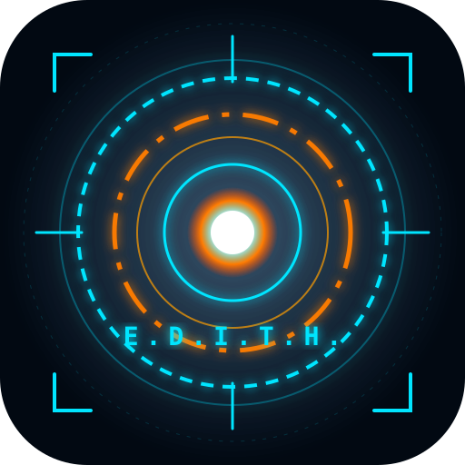

# 🕶️ E.D.I.T.H. — Samsung Galaxy S24 Ultra Edition

> **"Even Dead, I'm The Hero"**  
> *Assistant personnel, tactique et multimodal optimisé pour Samsung Galaxy S24 Ultra.*

---

## ⚡ Présentation de l'Édition S24 Ultra

Cette version d'**E.D.I.T.H.** a été spécialement conçue et dimensionnée pour exploiter les fonctionnalités matérielles du **Samsung Galaxy S24 Ultra** :

- 📐 **Châssis Titane & Lignes Architecturales** : Finitions angulaires précises inspirées du boîtier titane du S24 Ultra et de l'armure Mark XLV de Tony Stark.
- ⭕ **Halo Caméra Infinity-O** : Anneau laser HUD supérieur centré autour du poinçon circulaire de la caméra frontale.
- ✍️ **Stark Tactical Pad & Support S Pen** : Détection du stylet S Pen avec prise en charge des 4096 niveaux de pression, palette tactique (Cyan, Orange, Blanc, Rouge) et analyse multimodale directe de vos croquis par l'IA Gemini.
- 🖥️ **Écran Dynamic AMOLED 2X QHD+ & 120Hz** : Rendu ultra-net à 505 ppp avec noirs absolus et verre Gorilla Armor anti-reflet.
- 🗂️ **Onglet Protocoles Entièrement Repensé & Épuré** :
  - **Télémétrie Dynamique** : Batterie 5000 mAh, charge 45W, Snapdragon 8 Gen 3 for Galaxy, GPS orbital avec précision métrique.
  - **Journal de Bord avec Filtres** : Classement par catégories (*Missions, Idées, Urgent*), écoute vocale intégrée et suppression rapide.
  - **Minuteur LED & Boussole Azimutale 3D** : Affichage LED rétro-éclairé et aiguille magnétique réactive à l'orientation du smartphone.
  - **Balise de Détresse SOS** : Flash stroboscopique d'urgence avec copie instantanée des coordonnées GPS.
- 🗣️ **Voix & Écoute E.D.I.T.H.** : Reconnaissance vocale et synthèse vocale avec personnalité calme et tactique.
- 📷 **Vision AR 200MP Multimodale** : Analyse optique en direct avec Google Gemini Vision.

---

## 📱 Installation sur Samsung Galaxy S24 Ultra (PWA)

1. Ouvrez le lien de l'application dans **Samsung Internet**, **Google Chrome** ou **Brave** :  
   👉 **[https://bntserre.github.io/edith-s24-ultra/](https://bntserre.github.io/edith-s24-ultra/)**
2. Une bannière **« Installer sur mon S24 Ultra »** apparaît automatiquement.
3. Si ce n'est pas le cas, appuyez sur le menu (les **3 points** verticaux en haut à droite) puis sur **« Installer l'application »** ou **« Ajouter à l'écran d'accueil »**.
4. L'application s'installe sur votre écran d'accueil avec son icône haute résolution et s'exécute en plein écran sans barre de navigation du navigateur.

---

## 🌐 Deux Versions Disponibles

- 🍎 **Édition iPhone Air** : [https://bntserre.github.io/edith-ai/](https://bntserre.github.io/edith-ai/) *(Optimisée Dynamic Island & Safe Areas iOS)*
- 🤖 **Édition Galaxy S24 Ultra** : [https://bntserre.github.io/edith-s24-ultra/](https://bntserre.github.io/edith-s24-ultra/) *(Optimisée S Pen, Dynamic AMOLED 2X, Infinity-O & Protocoles épurés)*

---

*Développé pour honorer l'héritage de Tony Stark. Protocole E.D.I.T.H. MK-XLV.*
